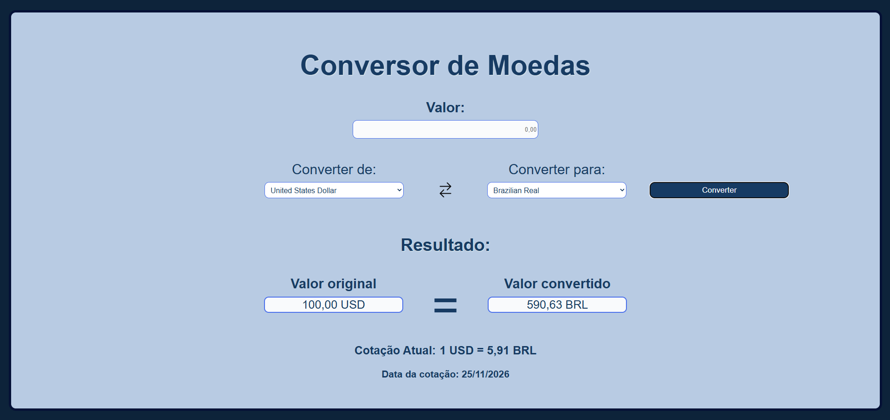

# Conversor de Moedas

Aplicação web desenvolvida com HTML, CSS e JavaScript, que permite converter valores entre diferentes moedas utilizando cotações atualizadas por meio de uma API.

## Funcionalidades

- Inserção de valores numéricos com até duas casas decimais.

- Bloqueio da entrada de letras e caracteres inválidos.

- Seleção de moedas de origem e destino.

- Conversão de valores entre as moedas selecionadas.

- Inversão das moedas de origem e destino.

- Exibição da cotação utilizada na conversão.

- Exibição da data da cotação.

## Tecnologias utilizadas

- HTML5
- CSS3
- JavaScript

## API utilizada

- [Frankfurter API](https://www.frankfurter.dev/)

## Como executar o projeto

1. Clone este repositório:
   `git clone https://github.com/devOnizuka/conversor-moedas.git`

2. Abra a pasta do projeto no VS Code.

3. Abra o arquivo `index.html` no navegador.

4. Ou acesse a aplicação diretamente pelo navegador:
[Conversor de Moedas](https://devonizuka.github.io/conversor-moedas/)

## Demonstração

